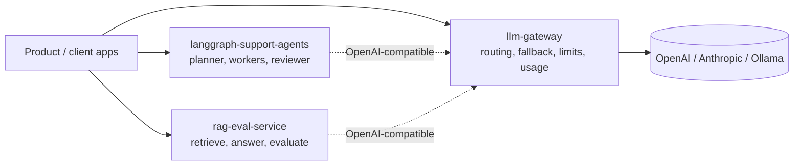

# Hi, I'm Hakim Rashid 👋

**AI Backend Engineer** · Node.js · TypeScript · Python · FastAPI · LangChain / LangGraph · RAG · India (open to GCC roles)

I've built scalable backend systems for 10+ years, and these days I focus on the infrastructure
that makes LLM features work reliably in production: retrieval pipelines that can be measured,
agent workflows with clear limits, and gateways that keep model providers interchangeable.

## Featured projects

| Project | What it is | Stack |
|---|---|---|
| [**rag-eval-service**](https://github.com/hakim86dev-eng/rag-eval-service) | FastAPI RAG service with hybrid retrieval (BM25 + dense, fused with RRF), cited answers, and an **evaluation harness** (hit-rate, MRR, recall, answer F1, faithfulness, refusal accuracy) that **gates CI on quality**. | Python, FastAPI, Pydantic, httpx, pytest |
| [**langgraph-support-agents**](https://github.com/hakim86dev-eng/langgraph-support-agents) | Multi-agent support backend: a **LangGraph** planner fans out to parallel **tool-using workers**, then a writer and a **reviewer** loop with a revision budget. Threads are checkpointed in SQLite and progress streams over SSE. | Python, LangGraph, LangChain, FastAPI, SQLite |
| [**llm-gateway**](https://github.com/hakim86dev-eng/llm-gateway) | **OpenAI-compatible LLM gateway** that routes to OpenAI, Anthropic and Ollama, with retries, fallback, circuit breakers, caching, per-key rate limits, SSE streaming, usage tracking and OpenAPI docs. | TypeScript, Node.js, Fastify, Zod, Vitest |

Every project includes:

- ✅ a test suite that runs **offline**, with mocked or fake LLM and embedding providers, so no API keys are needed
- ✅ strict typing (mypy `--strict` / TypeScript `strict`) plus linting (ruff / typescript-eslint)
- ✅ a multi-stage, non-root Dockerfile with a healthcheck, plus `docker-compose.yml`
- ✅ a GitHub Actions CI pipeline (lint, type-check, test matrix, Docker build)
- ✅ a README with a Mermaid architecture diagram, API examples and design decisions

## How the pieces fit together

The two Python services can use any OpenAI-compatible endpoint. If you point them at the
gateway, they get fallback, rate limiting and usage accounting with no extra code.

## Tech I work with

**Backend:** Node.js, TypeScript, Python, FastAPI, Express, Fastify, REST, microservices
**AI / LLM:** LangChain, LangGraph, RAG, embeddings, vector search (FAISS, ChromaDB), evaluation
**Data:** PostgreSQL, MySQL, MongoDB, query optimisation
**Cloud / DevOps:** AWS (EC2, Lambda, S3), Docker, Kubernetes, GitHub Actions, Nginx, Linux
**Security:** JWT, Azure AD SSO, HMAC, API key management

## Contact

- Email: hakim86.dev@gmail.com
- LinkedIn: [linkedin.com/in/rashid-hakim-78452a40](https://www.linkedin.com/in/rashid-hakim-78452a40)
